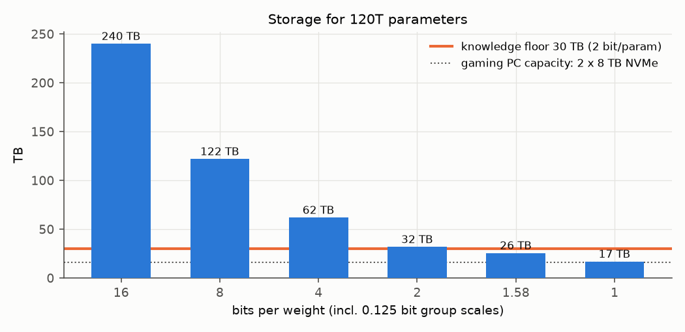

# TSG-120T

**Ein Sprachmodell mit 120 Billionen Parametern läuft auf einem Gaming-PC rechnerisch mit 9 bis 23 Tokens pro Sekunde.**


Rechenmodell mit Hardwaremessung, kein trainiertes Modell. Nicht veröffentlicht. Stand 17.11.2026.

## Auf einen Blick

- Ein dichtes 120T-Modell braucht auf einem Gaming-PC 2026 rechnerisch 37 Minuten pro Token. Ein klassisches MoE-Modell mit 0,1 % aktiven Parametern erreicht 0,70 Tok/s.
- Der Entwurf TSG erreicht auf demselben PC rechnerisch 9,3 bis 23 Tok/s. Die schlanke Variante erreicht 172 bis 215 Tok/s.
- Pro Token liest TSG 2,1 MB von der SSD. Das klassische MoE-Modell liest 40 GB, das dichte Modell 62 TB (berechnet).
- Die Qualität ist ungemessen. Ein trainiertes TSG-Modell gibt es noch nicht.

Schreibweise: Tok/s heißt Tokens pro Sekunde. 120T heißt 120 Billionen Parameter. Alle Werte gelten für eine Person, Batch 1, 4.096 Tokens Kontext.

## Problem

Große Modelle passen auch quantisiert nicht auf kleine Rechner.

- Das größte offene Modell im November 2026 ist Kimi K3 mit 2,8 Billionen Parametern. 120T sind das 43-Fache.
- Ein Gaming-PC 2026 hat eine RTX 5090 mit 32 GB, 192 GB DDR5 und zwei NVMe-SSDs mit je 8 TB.
- 120T Parameter belegen bei 4 Bit 62 TB, bei 16 Bit 240 TB (berechnet, siehe Grafik).
- Ein dichtes Modell liest für jedes Token alle Gewichte. Bei 62 TB und zwei PCIe-5.0-SSDs dauert ein Token 37 Minuten (berechnet). Schichtweises Laden wie bei AirLLM ergibt fast denselben Wert.
- Ein klassisches MoE-Modell mit 0,1 % aktiven Parametern liest pro Token noch 40 GB von der SSD. Der Gaming-PC erreicht 0,70 Tok/s, die beste Workstation 3,5 Tok/s (berechnet).
- Zwischenspeicher retten das MoE-Modell nicht. Der Gaming-PC hält 0,3 % der Expertendaten in VRAM und RAM. Selbst 60 % Wiederverwendung ergeben 1,6 bis 1,9 Tok/s (simuliert).
- Ein Schwarm aus Heim-PCs im Stil von Petals braucht 1.066 bis 2.579 Knoten und erreicht 0,006 bis 0,13 Tok/s (berechnet).



*Speicherbedarf von 120T Parametern nach Bitbreite, inklusive Skalen (berechnet). Die rote Linie zeigt die Wissensgrenze von 2 Bit pro Parameter nach Allen-Zhu und Li (2025).*

## Ergebnisse

### Hardware-Profile

| Profil | GPU | RAM | SSD |
|---|---|---|---|
| Testrechner | RTX 3050 6 GB | 31 GB DDR4, 13,9 bis 18,6 GB/s gemessen | 1 TB PCIe 3.0, 0,7 TB frei, gemessen |
| Gaming-PC 2026 | RTX 5090 32 GB | 192 GB DDR5, 90 GB/s angenommen | 2 x 8 TB PCIe 5.0 |
| Workstation | RTX 5090 32 GB | 768 GB DDR5, 8 Kanäle | 4 x 8 TB PCIe 5.0 |
| Mac Studio M3 Ultra | 512 GB gemeinsamer Speicher | gemeinsam, 819 GB/s | 1 x intern |

### Geschwindigkeit

Tok/s, berechnet. TSG-Zeilen zeigen den Bereich von pessimistischer bis optimistischer Effizienzannahme.

| Ansatz | aktive Parameter | Testrechner | Gaming-PC 2026 | Workstation | Mac Studio | Speicher |
|---|---|---|---|---|---|---|
| dicht, 4 Bit | 120T | 0,000046 | 0,00045 | 0,00092 | 0,00011 | 62 TB |
| klassisches MoE, 1 % aktiv, 4 Bit | 1,2T | 0,0048 | 0,068 | 0,14 | 0,016 | 62 TB |
| klassisches MoE, 0,1 % aktiv, 4 Bit | 120 Mrd. | 0,070 | 0,70 | 1,4 | 0,16 | 62 TB |
| TSG Standard, Entwurfsannahme | 40,1 Mrd. | 17 bis 23 ¹ | 9,3 bis 23 | 23 bis 47 | 26 bis 36 | 45 TB |
| TSG Standard, Annahme nach Literaturwerten ² | 40,1 Mrd. | 8,8 bis 12 ¹ | 4,2 bis 11 | 12 bis 28 | 21 bis 30 | 45 TB |
| TSG schlank | 8,5 Mrd. | 23 bis 31 | 172 bis 215 | 173 bis 216 | 103 bis 140 | 45 TB |
| DeepSeek-V4.1-Flash, trainiertes Vergleichsmodell | 16 Mrd. | 0,84 bis 0,88 | 11 bis 31 | 34 bis 83 | 104 bis 148 | 0,38 TB |

¹ Testrechner: kleinere Variante mit 9,4 Mrd. aktiven Parametern. Der Speicher ist hypothetisch, der Rechner hat 0,7 TB frei. Mit einer zusätzlichen 8-TB-NVMe und zwei Festplatten sind es 1,3 bis 2,4 Tok/s.

² Eine zentrale Kompressionsannahme des Entwurfs liegt bei 6. Veröffentlichte Messungen erreichen 1,3 bis 2,5. Die Zeile rechnet mit 2,5.

- Das Ziel von 5 Tok/s (etwa Lesetempo) hält TSG auf NVMe in allen Profilen mit der Entwurfsannahme.
- Bei 32.768 Tokens Kontext erreicht der Gaming-PC 8,5 bis 20,7 Tok/s, der Testrechner 5,5 bis 7,4 Tok/s (berechnet).
- Bei TSG ist die SSD in keinem NVMe-Szenario der Engpass. Es begrenzen RAM- oder GPU-Speicherbandbreite. Dichte und klassische MoE-Modelle begrenzt die SSD-Bandbreite.
- Die Rechenleistung begrenzt in keinem Szenario.

### Daten pro Token

| Ansatz | von der SSD gelesen pro Token | Art |
|---|---|---|
| dicht, 4 Bit | 62 TB | berechnet |
| klassisches MoE, 0,1 % aktiv | 40 GB | berechnet |
| TSG Standard | 2,1 MB | berechnet |

### Speicher und Kosten

- TSG mit 120T Parametern belegt 30 bis 45 TB. Das sind 4 bis 6 NVMe-SSDs mit je 8 TB für 5.600 bis 8.300 US-Dollar zu Marktpreisen (berechnet).
- Ein Trainingskorpus mit 30 Billionen Tokens füllt rechnerisch nur etwa 37 Billionen Parameter. Diese passen mit 9 bis 13 TB auf die zwei NVMe-SSDs des Gaming-PCs.

### Gemessen auf dem Testrechner

| Größe | Wert |
|---|---|
| GPU | RTX 3050 6 GB, 168 GB/s |
| RAM-Bandbreite, 1 bis 8 Prozesse | 13,9 bis 18,6 GB/s, 33 bis 44 % der Theorie von 42,7 GB/s |
| SSD sequenziell, 1 MiB, Warteschlange 32 | 3,03 GB/s |
| SSD zufällig, 4 KiB, Warteschlange 32 | 63.432 IOPS, p99 1,99 ms |
| SSD zufällig, 4 KiB, 4 Prozesse | 164.532 IOPS |

Alle SSD-Werte sind Mediane aus 3 Läufen mit je 8 Sekunden auf einer 8-GiB-Datei, Seitencache umgangen.

## Grenzen

- Alle Tok/s-Werte sind berechnet. Gemessen sind nur SSD und RAM des Testrechners.
- Kein TSG-Modell ist trainiert. Die Qualität ist ungemessen.
- Der Großteil der 120T Parameter wird pro Token nicht gerechnet. Veröffentlichte Arbeiten messen für selten genutzte Parameter auf Faktenfragen einen über 20-fach geringeren Wert pro Parameter als für dichte. Ob TSG die Qualität eines dichten 120T-Modells erreicht, ist offen.
- Die erste Fassung nannte 30 Tok/s für den Gaming-PC und nahm volle Parallelität an. Die Gegenprüfung senkte den Wert auf 9,3 bis 23 Tok/s.
- Mit Kompressionswerten aus veröffentlichten Messungen fällt der Gaming-PC auf 4,2 bis 11 Tok/s. Bei 57,6 GB/s RAM-Bandbreite (JEDEC-Wert für 4 Module) sind es 2,7 bis 7,5 Tok/s. Das Ziel von 5 Tok/s ist dann nicht sicher.
- 4 bis 6 NVMe-SSDs passen nicht in typische Gaming-PCs mit 2 bis 4 M.2-Plätzen. Eine Trägerkarte konkurriert mit der GPU um PCIe-Lanes.
- Ein Training mit 30 Billionen Tokens kostet rechnerisch 5,1 Mio. H100-Stunden, etwa 10 Mio. US-Dollar.
- Das trainierte DeepSeek-V4.1-Flash erreicht auf dem Gaming-PC rechnerisch 11 bis 31 Tok/s mit 0,38 TB Speicher.
- Die SSD-Messung lief auf 8 GiB Spannweite. Zufällige Lesezugriffe über mehrere TB sind auf Laufwerken ohne DRAM ungemessen. Die RAM-Messung lief unter Fremdlast.
- Die Hardware-Profile für Gaming-PC, Workstation und Mac Studio sind Datenblattannahmen. Preise sind Marktannahmen von 2026.

## Stand und Fahrplan

| Phase | Inhalt | Stand |
|---|---|---|
| Phase 1 | Rechenmodell, Simulation, SSD- und RAM-Messung | abgeschlossen |
| Prüfrunde 1 | Gegenprüfung, korrigiertes Zeitmodell, Nachmessungen | abgeschlossen |
| Phase 2 | Benchmark einer einzelnen Modellschicht auf dem Testrechner. Ziel: Rechenmodell trifft Messung auf plus minus 25 % | geplant |
| Phase 3 | RAM-Bandbreite auf ruhigem Rechner, Module neu stecken. Ziel: mindestens 30 GB/s | geplant |
| Phase 4 | Benchmark gegen das trainierte Vergleichsmodell DeepSeek-V4.1-Flash auf gemieteter Hardware | geplant |
| Phase 5 | SSD-Lasttests mit Dateien größer als der RAM: 0,5 TB, danach 1 und 10 TB | geplant |
| Phase 6 | Kleine Modelle trainieren und die Qualität gegen ein gleich schnelles MoE-Modell messen | geplant |

## Projektstruktur

```
tsg-120t/
  README.md
  MANIFEST.md
  requirements.txt
  assets/
  testbett/      Testdaten, Generatoren, Bewertungsskripte
  ergebnisse/    Messwerte und Auswertungen
```

Das Repository enthält das Testbett und die Ergebnisse. Jede Datei steht mit Zweck und Größe in `MANIFEST.md`. Code und Methodik des Verfahrens sind nicht Teil dieses Repositorys.

## Zugehörige Arbeit

- Interner Forschungsbericht, November 2026, unveröffentlicht.
- Eigene Vorarbeit (2026): KI-Effizienz auf Consumer-Hardware. Unveröffentlicht.
- Verwandtes Projekt: rosa-hardware bewertet TSG auf vorhandener und neuer Hardware.

## Lizenz

Alle Rechte vorbehalten. Keine Nutzung ohne Zustimmung.

Kontakt: auf Anfrage
